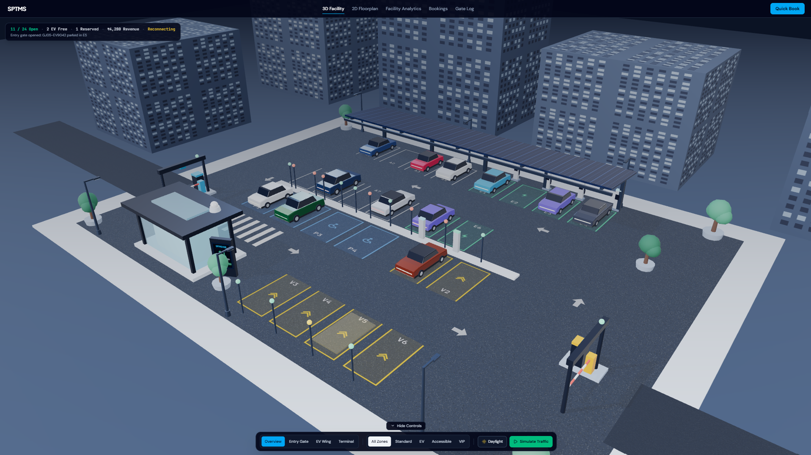
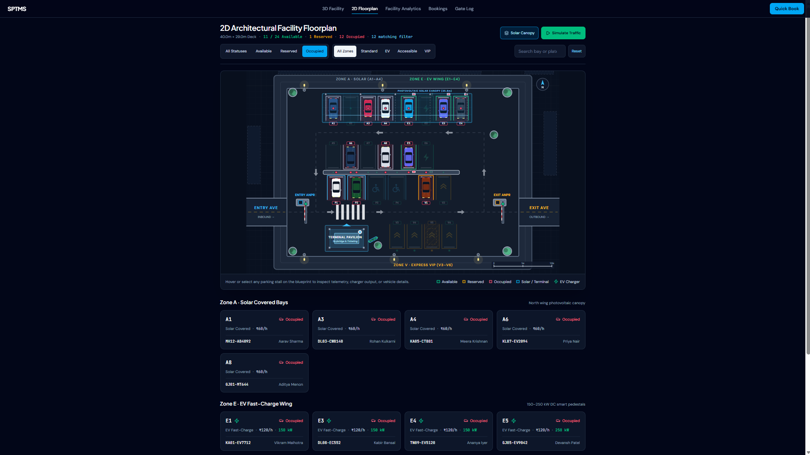

<div align="center">

# SPTMS
### Smart Parking & Traffic Management System

An interactive smart-parking operations dashboard with a real-time 3D facility, 2D floorplan, bay reservations, gate operations and facility analytics.


</div>

---

## Overview

SPTMS is a full-stack demonstration of a smart parking facility. It combines an interactive Three.js scene with a React operations interface and an Express/WebSocket server. Operators can inspect parking bays, reserve spaces, check bookings in, register walk-ins, release bays and review occupancy/revenue analytics. Connected browser clients receive state updates over WebSockets.

> **Important:** This repository currently uses in-memory server state and seeded demonstration data. It is intended as an academic/demo project, not as a production parking or payment platform. State resets when the server restarts. There is no authentication, database persistence, payment gateway or hardware sensor integration in the supplied code.

## Screenshots & Product Demo

### 3D Facility View

Explore the parking facility in an interactive 3D environment, including parking bays, vehicles, solar canopy, entry/exit gates and surrounding city context.



### 2D Architectural Floorplan

Inspect the facility layout, parking zones, bay occupancy, EV charging spaces, accessible bays and vehicle positions through the 2D floorplan.



### Product Demo

[▶ Watch the SPTMS product demo (MP4)](assets/product-demo.mp4)

> The screenshots and demo video are stored in the repository's `assets/` directory.

## Features

- **Interactive 3D facility:** orbit, zoom, camera presets, day/dusk lighting and selectable parking bays.
- **2D accessible floorplan:** a non-WebGL view of the facility with category/status filtering and bay selection.
- **Parking operations:** reservations, check-in, walk-in occupancy, bay release and simulated traffic activity.
- **Live synchronization:** Express REST endpoints and WebSocket broadcasts keep connected clients in sync.
- **Facility analytics:** occupancy metrics, hourly telemetry, revenue summaries, seven-day revenue projections and a demand heatmap.
- **Vehicle and bay categories:** standard, EV, accessible and VIP spaces, with vehicle-specific display details.
- **Automated logic tests:** tests cover validation, booking lifecycle, metrics, projections, heatmap and formatting.

## Technology stack

| Area | Technology |
|---|---|
| UI | React 19, TypeScript |
| Build tooling | Vite 8, `@vitejs/plugin-react` |
| 3D rendering | Three.js, OrbitControls |
| Styling | Tailwind CSS 4 |
| Charts | Recharts |
| Icons / motion | lucide-react, Motion |
| Server | Node.js, Express 4 |
| Live updates | WebSocket (`ws`) |
| Tests | Node test runner via `tsx` |

## Requirements

- Node.js **22.12.0 or newer** (Vite 8 requirement)
- npm 10 or newer (or a compatible package manager)
- A modern browser with WebGL 2 support for the 3D view; the 2D floorplan is available as a fallback

Check your versions:

```bash
node --version
npm --version
```

## Run locally

```bash
# 1. Clone the repository
git clone https://github.com/<your-username>/sptms-smart-parking-traffic-management.git
cd sptms-smart-parking-traffic-management

# 2. Install dependencies
npm install

# 3. Start the application (API + Vite development middleware)
npm run dev
```

Open **http://localhost:3000**. The Express server serves the Vite development middleware and the WebSocket endpoint from the same origin.

### Environment variables

No environment file or API key is required for the current feature set. The server reads:

| Variable | Default | Description |
|---|---:|---|
| `PORT` | `3000` | HTTP/WebSocket server port |
| `NODE_ENV` | unset | Set to `production` to serve the built frontend from `dist/` |

Example (PowerShell):

```powershell
$env:PORT = "3000"
npm run dev
```

Example (macOS/Linux):

```bash
PORT=3000 npm run dev
```

`.env.example` is retained as a starting point for future deployment configuration. Its historical Gemini/AI Studio variables are not consumed by the current application code; do not add secrets unless a feature actually requires them.

## Production build and run

```bash
npm install
npm run build

# macOS / Linux
NODE_ENV=production npm start

# Windows PowerShell
$env:NODE_ENV = "production"
npm start
```

The production server serves the Vite output from `dist/` and exposes the API and WebSocket endpoints on the same port. Configure your hosting provider to run the build command `npm run build` and start command `npm start`, with `NODE_ENV=production` and an appropriate `PORT`.

`npm run preview` starts Vite's static preview server; it does **not** run the Express API/WebSocket backend. Use `npm start` for a full production-mode application.

## Useful commands

| Command | Purpose |
|---|---|
| `npm run dev` | Start Express + Vite development server |
| `npm run build` | Type-check-independent Vite production bundle |
| `npm start` | Start the Express server (set `NODE_ENV=production` after building) |
| `npm run preview` | Preview the frontend bundle only |
| `npm run typecheck` | Run TypeScript checks |
| `npm run lint` | Alias for TypeScript checks; no ESLint config is included |
| `npm test` | Run parking-logic tests |
| `npm run clean` | Remove generated `dist/` output |

## Project structure

```text
.
├── .github/
│   ├── ISSUE_TEMPLATE/
│   └── pull_request_template.md
├── docs/
│   ├── CODE_REPORT.md
│   └── RELEASES.md
├── src/
│   ├── components/          # UI panels, floorplan, drawers and viewport
│   ├── hooks/               # REST + WebSocket client synchronization
│   ├── shared/              # Domain types, state transitions, analytics and tests
│   ├── three/               # Three.js scene, procedural models and textures
│   ├── App.tsx              # Main application composition and UI state
│   ├── index.css
│   └── main.tsx             # React entry point
├── server.ts                # Express API, WebSocket server and app hosting
├── index.html
├── package.json
├── tsconfig.json
└── vite.config.ts
```

For a detailed explanation of modules, data flow, algorithms, API routes and current limitations, see **[Code Report](docs/CODE_REPORT.md)**.

## API overview

All routes are served by the same Express process as the frontend.

| Method | Route | Purpose |
|---|---|---|
| `GET` | `/api/health` | Health check, connected-client count and bay count |
| `GET` | `/api/state` | Current facility snapshot |
| `POST` | `/api/bookings` | Reserve a bay |
| `POST` | `/api/bookings/:id/checkin` | Check in a reservation |
| `POST` | `/api/bays/:bayId/walkin` | Register a walk-in vehicle |
| `POST` | `/api/bays/:bayId/release` | Release/cancel a bay and complete checkout |
| `POST` | `/api/simulate` | Apply one simulated traffic pulse |
| WebSocket | `/ws` | Initial state and live facility updates |

The booking request body uses `bayId`, `driverName`, `licensePlate`, `vehicleType` and `durationHours`. See `BookingInput` in `src/shared/parkingLogic.ts` for the authoritative types and validation rules.

## Tests and quality checks

```bash
npm test
npm run typecheck
npm run build
```

The current automated suite focuses on the shared domain layer. It does not constitute end-to-end browser, load, security or hardware-integration testing.

## GitHub releases

The repository starts at version **1.0.0**. Follow semantic versioning:

- `PATCH` (1.0.1): backward-compatible bug fixes and documentation corrections.
- `MINOR` (1.1.0): backward-compatible features.
- `MAJOR` (2.0.0): breaking API, data-model or user-facing changes.

See **[Release Guide](docs/RELEASES.md)** for tagging and publishing a GitHub Release.

## Contributing

Issues and pull requests are welcome. Please read [CONTRIBUTING.md](CONTRIBUTING.md), include reproduction steps for bugs, and run tests/type checks before submitting changes.

## Security

Do not deploy this demo with real customer or vehicle data. Review [SECURITY.md](SECURITY.md) before exposing it to a network. Please report vulnerabilities privately rather than posting exploit details in a public issue.

## License

This project is licensed under the **MIT License**. See [LICENSE](LICENSE) for the full text. Third-party packages and any externally sourced assets remain subject to their own licenses and terms.
